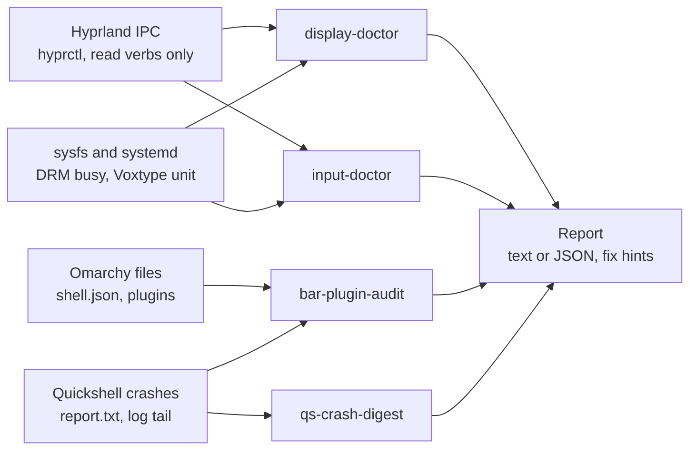

# omarchy-doctors

Four read-only diagnostics for an Omarchy desktop (Arch Linux, Hyprland, Quickshell). Each one is a single Python file that reads system state and prints a report with fix hints. None of them changes anything.

| Tool | Answers |
| --- | --- |
| `display-doctor` | Why does the display lag? Wrong mode, VRR, effects, GPU load, stale Hyprland instances |
| `input-doctor` | Is dictation, screenshot-and-paste and clipboard plumbing wired up? 13 checks |
| `bar-plugin-audit` | Which shell plugins are installed, enabled, in the bar layout, and crashing? Plus a QML hazard scan |
| `qs-crash-digest` | Which Quickshell crashes repeat? Groups reports by signal, top frame and last plugin loaded |

## Hardware and on-prem

- They run on the Linux desktop they inspect. No GPU is required, no server and no install: each tool is one Python file.
- Nothing leaves the machine. They make no network calls and write no files. They read `hyprctl` output, `/sys`, local config and crash reports.
- `display-doctor` reports GPU load only where sysfs exposes `gpu_busy_percent` (amdgpu). Use `nvidia-smi` for NVIDIA.

## How it works



`display-doctor` and `input-doctor` find the live Hyprland instance themselves, so a stale `HYPRLAND_INSTANCE_SIGNATURE` in your shell does not hide the problem. `display-doctor` allows only the `monitors` and `getoption` verbs. Any other verb raises before a process starts, and the tests cover that. `bar-plugin-audit` and `qs-crash-digest` read files only and never call `hyprctl`.

## Stack

Python 3 standard library only. No packages to install.

## Build and run

```bash
git clone https://github.com/thefiredev-cloud/omarchy-doctors.git
cd omarchy-doctors
./scripts/test.sh                      # 97 tests across the four tools
./display-doctor/display-doctor        # text report, add --json for machine output
./input-doctor/input-doctor --strict   # exit 1 if any check fails
python3 bar-plugin-audit/bar_plugin_audit.py --json
python3 qs-crash-digest/qs_crash_digest.py --since 24
```

[BUILD.md](BUILD.md) lists every flag and what each tool reads.

## Limits

- `display-doctor` reads GPU load only where sysfs exposes `gpu_busy_percent` (amdgpu). On NVIDIA it says "not exposed".
- `input-doctor` checks one dictation setup (Voxtype, Alt+Z screenshot bind, wtype and ydotool). Adjust the checks if yours differs.
- `bar-plugin-audit` crash counts use the last `plugins/<dir>` path in each crash log, which is a hint and not proof. QML hazard hits are risk flags.
- Tested against Omarchy 4.0.x with Quickshell 0.3.

## License

Copyright 2026 Tanner Osterkamp. All rights reserved. See [LICENSE](LICENSE). The source is public to read; ask before reuse.
